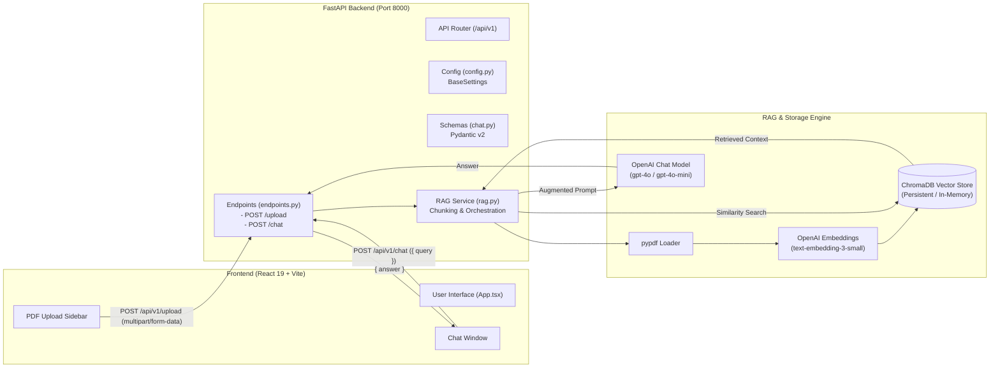

# AGENTS.md — Repository Guide for AI Agents

Welcome to **`rag-micro-demo`**. This document provides an exhaustive reference for AI agents and human developers navigating, extending, and operating within this codebase. Always consult these instructions, architectural boundaries, and conventions before making changes.

---

## 1. Project Overview & Architecture

`rag-micro-demo` is a micro-application implementing an **Enterprise Retrieval-Augmented Generation (RAG)** pipeline for querying proprietary business documents (specifically PDFs).

The system consists of two main subsystems:
1. **Frontend (`frontend/`)**: A modern, single-page application built with React 19, TypeScript, Vite, and Tailwind CSS. It features a document upload sidebar for vectorizing PDFs and a chat interface for semantic Q&A.
2. **Backend (`app/` + `backend/`)**: A high-performance Python ASGI application built with FastAPI, LangChain, OpenAI, and ChromaDB. It handles document parsing, vector embedding generation, vector store persistence, and retrieval-augmented LLM completion.

### Architecture Diagram



### The Two Primary Workflows

The application operates via two discrete pipelines (see [SPEC.md](file:///E:/rag-micro-demo/SPEC.md) for full sequence diagrams):

1. **Workflow 1: Document Ingestion Pipeline (`POST /api/v1/upload`)**:
   - `User Upload (PDF)` $\rightarrow$ `FastAPI (/upload)` $\rightarrow$ `pypdf Text Extraction` $\rightarrow$ `RecursiveCharacterTextSplitter (1000/200)` $\rightarrow$ `OpenAI Embeddings (text-embedding-3-small)` $\rightarrow$ `ChromaDB Persistence`.
2. **Workflow 2: Semantic Retrieval & Generation Pipeline (`POST /api/v1/chat`)**:
   - `User Query` $\rightarrow$ `FastAPI (/chat)` $\rightarrow$ `OpenAI Query Embedding` $\rightarrow$ `ChromaDB Top-k Similarity Search` $\rightarrow$ `Grounding Prompt Augmentation` $\rightarrow$ `OpenAI LLM (gpt-4o / gpt-4o-mini)` $\rightarrow$ `Answer to Frontend Chat UI`.

---

## 2. Directory Structure

```text
rag-micro-demo/
├── docker-compose.yml         # ChromaDB vector database container setup
├── AGENTS.md                  # This file: definitive guide for AI agents
├── SPEC.md                    # Detailed architectural and functional specification
├── backend/                   # Self-contained FastAPI backend service
│   ├── .env                   # Local environment variables (GOOGLE_API_KEY, etc.)
│   ├── main.py                # FastAPI entrypoint (run via: uvicorn main:app)
│   ├── requirements.txt       # Core pinned Python dependencies
│   ├── venv/                  # Python 3.12 virtual environment
│   └── app/                   # FastAPI application package
│       ├── __init__.py        # Package marker
│       ├── api/
│       │   ├── __init__.py
│       │   └── endpoints.py   # API route definitions (/upload, /chat, /chat/history)
│       ├── core/
│       │   ├── __init__.py
│       │   └── config.py      # Pydantic BaseSettings & configuration
│       ├── db/
│       │   ├── __init__.py
│       │   └── session.py     # SQLite engine, SessionLocal & get_db dependency
│       ├── models/
│       │   ├── __init__.py
│       │   └── chat.py        # SQLAlchemy ChatMessage ORM model
│       ├── schemas/
│       │   ├── __init__.py
│       │   └── chat.py        # Pydantic v2 request/response models
│       └── services/
│           ├── __init__.py
│           └── rag.py         # RAG engine: PDF parsing, ChromaDB client, Gemini LLM
└── frontend/                  # React 19 + TypeScript + Vite frontend application
    ├── public/                # Static assets (favicons, SVG icons)
    ├── src/
    │   ├── assets/            # Component assets (hero image, logos)
    │   ├── App.css            # Scoped component styles
    │   ├── App.tsx            # Main chat & document upload view
    │   ├── index.css          # Tailwind CSS layer directives (@tailwind)
    │   └── main.tsx           # React DOM root entrypoint
    ├── eslint.config.js       # ESLint 10 flat configuration
    ├── index.html             # HTML root document
    ├── package.json           # Frontend dependencies and npm scripts
    ├── postcss.config.js      # PostCSS configuration for Tailwind
    ├── tailwind.config.js     # Tailwind CSS configuration
    ├── tsconfig.app.json      # TypeScript compiler settings for frontend source
    ├── tsconfig.json          # Root TypeScript project references
    ├── tsconfig.node.json     # TypeScript settings for Vite node tooling
    └── vite.config.ts         # Vite configuration with React plugin
```

### Module Responsibilities

| Path | Primary Responsibility |
| :--- | :--- |
| `docker-compose.yml` | Starts the standalone ChromaDB vector store on port `8001`. |
| `backend/main.py` | Initializes `FastAPI()`, mounts CORS middleware (`http://localhost:5173`), includes `/api/v1` router, and provides root/health check endpoints. |
| `backend/app/core/config.py` | Defines `Settings` using `pydantic-settings` to load `.env` variables (`GOOGLE_API_KEY`, Chroma host/port, chunk size, model names). |
| `backend/app/db/session.py` | Initializes SQLite engine, declarative base, and FastAPI `get_db` session dependency. |
| `backend/app/models/chat.py` | Defines `ChatMessage`, `ChatSession`, and `ChatDocument` SQLAlchemy ORM entities for persisting conversations and document associations. |
| `backend/app/schemas/chat.py` | Declares data transfer schemas: `ChatRequest`, `ChatResponse`, `UploadResponse`, `ChatSessionsListResponse`, and `ChatHistoryResponse`. |
| `backend/app/services/rag.py` | Encapsulates PDF parsing (`pypdf`), text chunking (`RecursiveCharacterTextSplitter`), embedding generation, ChromaDB vector indexing (Docker or local fallback), and Gemini retrieval QA. |
| `backend/app/api/endpoints.py` | FastAPI `APIRouter(prefix="/api/v1")` binding HTTP requests to `rag.py` service methods. |
| `frontend/src/App.tsx` | Single-page UI containing sidebar PDF upload trigger, vectorization progress indicator, interactive chat history, and input form. |

---

## 3. Tech Stack & Dependencies

### Backend Stack

| Technology | Version | Purpose |
| :--- | :--- | :--- |
| **Python** | `3.12.3` | Execution runtime (located in `backend/venv`) |
| **FastAPI** | `~0.163` | Modern, high-performance async REST framework |
| **Uvicorn** | `~0.54` | ASGI server with auto-reload capabilities |
| **LangChain** | `~1.5` | Orchestration framework for LLMs and document chains |
| **LangChain-OpenAI** | `~1.8` | Integration package for OpenAI embeddings & completions |
| **ChromaDB** | `~1.5` | Embedded open-source vector store for embeddings |
| **OpenAI SDK** | `~3.51` | Official OpenAI client library |
| **pypdf** | `~7.1` | Native PDF document extraction and page reading |
| **SQLAlchemy** | `~2.1` | Relational ORM for SQLite chat persistence |
| **Pydantic / Pydantic Settings** | `~2.14` / `~2.16` | Data validation and type-safe environment configuration |
| **python-multipart** | `~0.0.33` | Parsing `multipart/form-data` for file uploads |
| **python-dotenv** | `~1.2` | `.env` file loader for development |

### Frontend Stack

| Technology | Version | Purpose |
| :--- | :--- | :--- |
| **React** | `^19.3.1` | Modern UI library utilizing React 19 functional patterns |
| **TypeScript** | `~6.0.3` | Strict type checking and safety (`target: es2023`) |
| **Vite** | `^8.3.6` | Next-generation frontend build tool and dev server |
| **Tailwind CSS** | `^3.4.19` | Utility-first CSS framework |
| **Axios** | `^1.21.1` | Promise-based HTTP client for backend communication |
| **Lucide React** | `^1.73.0` | Accessible, consistent icon set |
| **ESLint** | `^10.14.0` | Code quality and React hooks linting |

---

## 4. API Contracts & Integration

The frontend (`frontend/src/App.tsx`) communicates directly with the backend at `http://localhost:8000`. Any backend implementation must satisfy the following contract:

### 1. Document Upload Endpoint (Chat-Scoped)

- **Endpoint**: `POST /api/v1/upload`
- **Content-Type**: `multipart/form-data`
- **Request Body**:
  - `file`: `UploadFile` (Binary PDF file, validated with MIME type `application/pdf` or `.pdf` extension)
  - `session_id`: `str | None` (Optional session identifier; if omitted, generates a new conversation thread)
- **Response**: `200 OK`
  ```json
  {
    "status": "success",
    "filename": "document.pdf",
    "chunks_indexed": 42,
    "session_id": "session_3f8a1290",
    "message": "Document 'document.pdf' uploaded and attached to conversation session_3f8a1290!"
  }
  ```
- **Error Responses**:
  - `400 Bad Request`: If no file provided or file is not a PDF.
  - `500 Internal Server Error`: If PDF extraction or embedding fails.

### 2. Chat / Query Endpoint

- **Endpoint**: `POST /api/v1/chat`
- **Content-Type**: `application/json`
- **Request Body**:
  ```json
  {
    "query": "What are the quarterly financial projections?"
  }
  ```
- **Response**: `200 OK`
  ```json
  {
    "answer": "According to page 4 of the document, the projected revenue for Q4 is...",
    "sources": ["chunk-12", "chunk-13"]
  }
  ```
  *(Note: Frontend consumes `response.data.answer` directly).*
- **Error Responses**:
  - `400 Bad Request`: When `query` is empty or missing.
  - `500 Internal Server Error`: When retrieval or LLM inference fails.

### 3. Chat Session & History Endpoints (Persistence)

- **List All Sessions**: `GET /api/v1/chat/sessions`
  - **Response**: `200 OK`
    ```json
    {
      "sessions": [
        {
          "id": "session_3f8a1290",
          "title": "Summarize the core features",
          "created_at": "2026-11-18T21:49:25.715Z",
          "updated_at": "2026-11-18T21:50:10.120Z",
          "message_count": 4,
          "documents": ["report1.pdf", "report2.pdf"]
        }
      ]
    }
    ```

- **Fetch Session History**: `GET /api/v1/chat/history?session_id=<session_id>`
  - **Response**: `200 OK`
    ```json
    {
      "session_id": "session_3f8a1290",
      "title": "Summarize the core features",
      "documents": ["report1.pdf", "report2.pdf"],
      "messages": [
        {
          "id": 1,
          "session_id": "session_3f8a1290",
          "role": "user",
          "content": "Summarize the document",
          "created_at": "2026-11-18T21:49:25.715Z"
        },
        {
          "id": 2,
          "session_id": "session_3f8a1290",
          "role": "bot",
          "content": "Based on the provided document...",
          "created_at": "2026-11-18T21:49:26.500Z"
        }
      ]
    }
    ```
- **Delete Session**: `DELETE /api/v1/chat/history?session_id=<session_id>`
  - **Response**: `200 OK`
    ```json
    {
      "status": "success",
      "message": "Cleared 2 messages from conversation session_3f8a1290.",
      "deleted_count": 2
    }
    ```

### 4. CORS Configuration

The backend `FastAPI` instance in `backend/main.py` must configure `CORSMiddleware`:
```python
from fastapi.middleware.cors import CORSMiddleware

app.add_middleware(
    CORSMiddleware,
    allow_origins=["http://localhost:5173", "http://127.0.0.1:5173"],
    allow_credentials=True,
    allow_methods=["*"],
    allow_headers=["*"],
)
```

---

## 5. Key Commands

All commands below assume execution from PowerShell on Windows.

### Database Commands (Docker)

| Task | Command | Notes |
| :--- | :--- | :--- |
| **Start ChromaDB Container** | `docker compose up -d` | Starts ChromaDB on port 8001 |
| **Stop ChromaDB Container** | `docker compose down` | Stops the database container |
| **Check Container Status** | `docker compose ps` | Verifies container health |
| **View ChromaDB Logs** | `docker compose logs -f chromadb` | Streams database logs |

### Backend Commands

Run these inside `backend/` directory:

| Task | Command | Notes |
| :--- | :--- | :--- |
| **Activate Virtual Environment** | `cd backend; .\venv\Scripts\Activate.ps1` | Activates Python 3.12 venv |
| **Run Backend Dev Server** | `cd backend; uvicorn main:app --reload --port 8000` | Runs FastAPI directly from `backend/` |
| **Direct Execution via venv** | `.\backend\venv\Scripts\python.exe -m uvicorn main:app --app-dir backend --reload --port 8000` | Runs without activating venv |
| **Check Installed Packages** | `.\backend\venv\Scripts\python.exe -m pip list` | Lists all backend packages |
| **Install New Package** | `.\backend\venv\Scripts\python.exe -m pip install <package>` | Installs package into `backend/venv` |

### Frontend Commands

Run these inside `frontend/` directory (or use `npm --prefix frontend <command>` from root):

| Task | Command | Notes |
| :--- | :--- | :--- |
| **Install Dependencies** | `cd frontend; npm install` | Installs node modules |
| **Run Frontend Dev Server** | `cd frontend; npm run dev` | Starts Vite dev server on `http://localhost:5173` |
| **Build for Production** | `cd frontend; npm run build` | Compiles TypeScript (`tsc -b`) and bundles Vite |
| **Run ESLint** | `cd frontend; npm run lint` | Runs ESLint 10 over TS/TSX files |
| **Preview Production Build** | `cd frontend; npm run preview` | Locally serves the production `dist/` bundle |

### Concurrent Local Development

To run all services simultaneously during development:
1. **Terminal 1 (Database via Docker)**:
   ```powershell
   docker compose up -d
   ```
2. **Terminal 2 (Backend)**:
   ```powershell
   cd backend
   .\venv\Scripts\activate
   uvicorn main:app --reload --port 8000
   ```
3. **Terminal 3 (Frontend)**:
   ```powershell
   cd frontend
   npm run dev
   ```

---

## 6. Coding Conventions & Best Practices

### Python / Backend Guidelines

1. **Strict Type Annotations**:
   - Utilize modern Python 3.12+ type hints (`str | None`, `list[dict[str, Any]]`) rather than legacy `typing.Optional` / `typing.List`.
   - All function signatures must include parameter types and return type annotations.

2. **Pydantic v2 Patterns**:
   - Define data schemas using `pydantic.BaseModel`.
   - Settings must inherit from `pydantic_settings.BaseSettings` with `SettingsConfigDict(env_file="backend/.env")`.
   - Never hardcode API keys or secret tokens in source files.

3. **Separation of Concerns**:
   - **`endpoints.py`**: Handles HTTP parsing, validation, and status codes. Should NOT perform heavy computation or direct vector store manipulation.
   - **`rag.py`**: Encapsulates all LangChain / ChromaDB logic as reusable classes or functions (e.g. `RAGService`).
   - **`config.py`**: Central source of truth for runtime configurations, paths, and model hyper-parameters.

4. **Error Handling**:
   - Catch specific exceptions in services and raise standard FastAPI `HTTPException(status_code=..., detail=...)`.
   - Provide informative error messages in JSON responses for the frontend.

5. **Path Handling**:
   - Use `pathlib.Path` for all local file operations (e.g., temporary file uploads, ChromaDB persistence paths) to guarantee cross-platform compatibility between Windows and POSIX.

### TypeScript / Frontend Guidelines

1. **React 19 & Functional Components**:
   - Write purely functional components with hooks (`useState`, `useEffect`, `useRef`, `useCallback`).
   - Avoid legacy class components or mutation of state objects.

2. **Strict TypeScript Typing**:
   - Avoid `any`. Define explicit interfaces/types for all state variables, component props, and API payloads.
   - For example:
     ```typescript
     interface Message {
       role: 'user' | 'bot';
       content: string;
     }

     interface ChatResponse {
       answer: string;
       sources?: string[];
     }
     ```

3. **Styling with Tailwind CSS**:
   - Use Tailwind utility classes directly in `className`.
   - Follow clean spacing, flexbox/grid layouts, and enterprise-grade visual hierarchy (soft borders, rounded corners, subtle shadows).
   - Icons must be imported from `lucide-react`.

4. **Async Operations & UI State**:
   - Always track loading (`isLoading`, `isUploading`) and error states to provide immediate user feedback (e.g., `<Loader2 className="animate-spin" />`).
   - Clean up asynchronous subscriptions or timeouts in `useEffect` returns.

---

## 7. Instructions for AI Agents Working on This Repository

When tasked with implementing features, fixing bugs, or refactoring code:

1. **Preserve the Virtual Environment**: Always use the pre-configured virtual environment located in `backend/venv/`. Do not create a separate virtual environment in the root or overwrite existing packages without verification.
2. **Respect the API Contract**: `frontend/src/App.tsx` expects the backend endpoints to be strictly at `/api/v1/upload` and `/api/v1/chat`. Do not rename these routes without synchronizing the frontend.
3. **Environment Variables**: When implementing RAG functionality in `app/core/config.py`, read from `backend/.env`. Document any new required environment variables in this file (`AGENTS.md`) and provide reasonable defaults where possible.
4. **Windows Pathing Caution**: Commands executed through agent tools run on Windows PowerShell. Ensure path separators are appropriately escaped or handled using standard PowerShell semantics.
5. **Validation Before Completion**:
   - For frontend changes: Run `npm run lint` and `npm run build` in `frontend/` to confirm there are no type errors or build failures.
   - For backend changes: Verify syntax with `python -m py_compile <file>` and ensure the FastAPI app imports cleanly via `uvicorn backend.main:app`.
