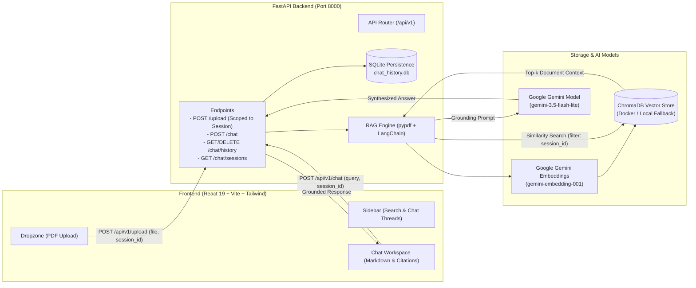

# Enterprise RAG Micro-Application

An enterprise-grade **Retrieval-Augmented Generation (RAG)** platform for semantic search, multi-document synthesis, and conversational Q&A over proprietary business PDFs. Built with **FastAPI**, **LangChain**, **Google Gemini**, **ChromaDB**, and a modern **React 19 + TypeScript + Vite + Tailwind CSS** frontend.

---

## 🌟 Key Features

- **Chat-Scoped Document Ingestion**: Documents uploaded to a conversation thread are tagged with `session_id`. Queries strictly search within the documents attached to that specific conversation without cross-chat data leakage.
- **Multi-Document PDF Ingestion**: Attach multiple business PDFs to a single conversation thread. The AI synthesizes context across all attached documents with verifiable page citations.
- **Anti-Hallucination Grounding**: Powered by Google Gemini (`gemini-3.5-flash-lite`) and `gemini-embedding-001`, answers cite source documents and page numbers (`[Doc.pdf (Page X)]`).
- **Dual Persistence Architecture**:
  - **Vector Persistence**: Standalone **ChromaDB** container (Docker port `8001`) with automatic local fallback.
  - **Relational Persistence**: Full SQLite + SQLAlchemy ORM backend storing chat threads, messages, and document associations in `backend/chat_history.db`.
- **Modern Executive UI**:
  - Obsidian dark navigation sidebar with real-time thread search and document counts.
  - Collapsible sidebar for distraction-free reading.
  - Native drag-and-drop PDF dropzone.
  - Formatted markdown response renderer with code syntax blocks and clickable citation pills.
  - Action templates on new conversations (Executive Summary, Core Features, Technical Architecture, Milestones).

---

## 🏗️ Architecture



---

## 🛠️ Tech Stack

### Backend
- **Python 3.12**
- **FastAPI** & **Uvicorn**
- **LangChain** (`langchain-core`, `langchain-google-genai`, `langchain-chroma`, `langchain-text-splitters`)
- **ChromaDB** (standalone Docker service or embedded local fallback)
- **Google Gemini SDK** (`google-genai`)
- **SQLAlchemy 2.1** (relational SQLite ORM)
- **pypdf** (native PDF document extraction)
- **Pydantic v2** & **Pydantic-Settings**

### Frontend
- **React 19**
- **TypeScript 5.x**
- **Vite 6.x**
- **Tailwind CSS 3.x**
- **Axios**
- **Lucide React** (modern iconography)

---

## 🚀 Getting Started

### Prerequisites
- [Git](https://git-scm.com/)
- [Python 3.12+](https://www.python.org/)
- [Node.js 18+](https://nodejs.org/)
- [Docker Desktop](https://www.docker.com/) (Optional: for standalone ChromaDB)
- [Google Gemini API Key](https://aistudio.google.com/)

---

### Step 1: Clone the Repository
```bash
git clone https://github.com/<your-username>/rag-micro-demo.git
cd rag-micro-demo
```

---

### Step 2: Start Vector Database (ChromaDB via Docker)
```bash
docker compose up -d
```
*(Note: If Docker is offline, the backend automatically falls back to local disk storage in `backend/chroma_data/`)*.

---

### Step 3: Configure & Run Backend Service

1. Navigate to the backend directory:
   ```bash
   cd backend
   ```
2. Create and activate a virtual environment:
   ```bash
   # Windows PowerShell:
   python -m venv venv
   .\venv\Scripts\Activate.ps1

   # Linux / macOS:
   python3 -m venv venv
   source venv/bin/activate
   ```
3. Install pinned Python dependencies:
   ```bash
   pip install -r requirements.txt
   ```
4. Create `.env` file from `.env.example`:
   ```bash
   cp .env.example .env
   ```
   Add your Google Gemini API key in `backend/.env`:
   ```env
   GOOGLE_API_KEY=your_actual_api_key_here
   GEMINI_MODEL=gemini-3.5-flash-lite
   EMBEDDING_MODEL=gemini-embedding-001
   CHROMA_HOST=localhost
   CHROMA_PORT=8001
   ```
5. Start the FastAPI development server:
   ```bash
   uvicorn main:app --reload --port 8000
   ```
   API docs will be available at [http://localhost:8000/docs](http://localhost:8000/docs).

---

### Step 4: Configure & Run Frontend Application

1. Open a new terminal and navigate to the frontend directory:
   ```bash
   cd frontend
   ```
2. Install npm dependencies:
   ```bash
   npm install
   ```
3. Start the Vite development server:
   ```bash
   npm run dev
   ```
4. Open your browser at [http://localhost:5173](http://localhost:5173).

---

## 📡 API Overview

| Method | Endpoint | Description |
| :--- | :--- | :--- |
| `POST` | `/api/v1/upload` | Uploads and vectorizes a PDF attached to a specific `session_id`. |
| `POST` | `/api/v1/chat` | Executes RAG similarity search scoped to `session_id` and invokes Gemini. |
| `GET` | `/api/v1/chat/sessions` | Lists all chat sessions with metadata and attached documents. |
| `GET` | `/api/v1/chat/history` | Fetches full message history and documents for a session. |
| `DELETE` | `/api/v1/chat/history` | Purges a session, its SQLite records, and ChromaDB vector embeddings. |
| `GET` | `/health` | Health check probe. |

---

## 📄 License
This project is licensed under the MIT License.
