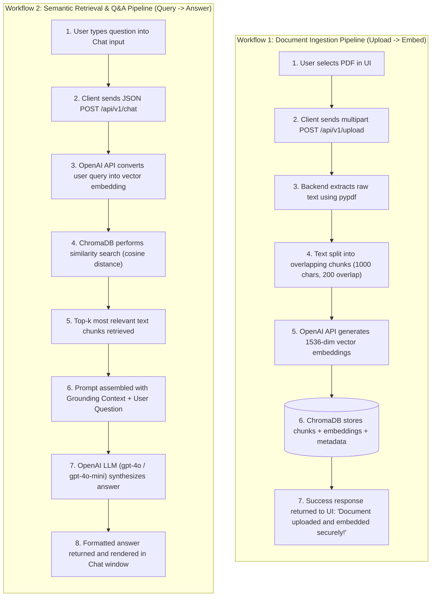
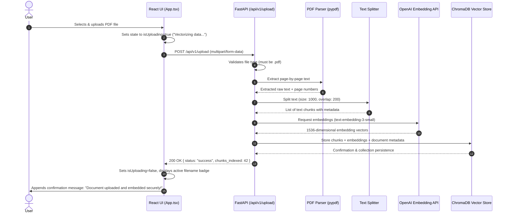
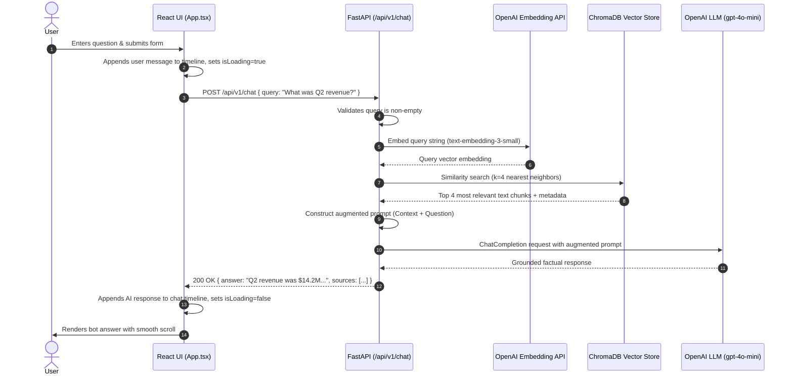

# Project Specification: Enterprise RAG Micro-Application (`rag-micro-demo`)

**Version:** 1.0.0  
**Status:** In Progress / Active Development  
**Audience:** Software Engineers, System Architects, Product Teams, and AI Agent Contributors  

---

## 1. Executive Summary & Objective

### 1.1 Purpose
**`rag-micro-demo`** is a micro-application implementing an **Enterprise Retrieval-Augmented Generation (RAG)** system designed to allow users to upload proprietary business documents (specifically PDFs) and interact with their content through a semantic, natural-language chat interface.

### 1.2 Problem Statement
Public large language models (LLMs) suffer from two fundamental limitations when dealing with private organizational data:
1. **Knowledge Cutoffs & Privacy Boundaries**: LLMs cannot access private company documents (e.g., quarterly financial reports, internal guidelines, operational standard operating procedures) that were not part of their training set.
2. **Context Window & Cost Constraints**: Feeding entire 50-to-100-page PDF documents into LLM prompts on every turn hits context limits, incurs high API latency and cost, and leads to hallucinations or "lost-in-the-middle" attention degradation.

### 1.3 Solution
This application implements an end-to-end RAG architecture:
- Parses PDF files into structured text using `pypdf`.
- Splits text into semantically coherent, overlapping chunks using recursive character splitting.
- Embeds text chunks as high-dimensional vectors with OpenAI (`text-embedding-3-small`).
- Stores embeddings in a fast, embedded vector store (**ChromaDB**).
- Retrieves the top-$k$ most semantically relevant passages matching the user's query and augments an LLM prompt (`gpt-4o` / `gpt-4o-mini`) to synthesize an accurate, source-grounded response.

---

## 2. User Stories & Acceptance Criteria

### US-1: PDF Upload & Vectorization
- **As a** business user or analyst,  
- **I want to** upload a PDF file through an intuitive drag-and-drop or file-picker interface,  
- **So that** the document is parsed, chunked, and vectorized into the searchable knowledge base.
- **Acceptance Criteria**:
  - The upload UI accepts only valid `.pdf` files.
  - While vectorization is in progress, a loading spinner and message ("Vectorizing data...") is displayed.
  - Upon successful indexing, a confirmation message appears in the chat: *"Document uploaded and embedded securely! You can now query the data."*
  - The filename remains visible in the sidebar as the active document context.

### US-2: Semantic Document Q&A
- **As a** user who has uploaded a document,  
- **I want to** ask natural-language questions about the document in a chat window,  
- **So that** I receive accurate, concise answers derived directly from the uploaded material.
- **Acceptance Criteria**:
  - The input bar is enabled once a document has been successfully indexed.
  - The user can submit questions via Enter key or Send button.
  - A loading indicator ("Searching knowledge base...") displays while the backend retrieves context and queries the LLM.
  - The AI assistant's response is appended to the chat timeline with clear visual separation between user and bot messages.

### US-3: Robust Error Handling & Feedback
- **As a** user,  
- **I want to** see clear error indications if the backend is unreachable or document parsing fails,  
- **So that** I understand why an action did not succeed.
- **Acceptance Criteria**:
  - Network failure or server errors (e.g., HTTP 500) produce non-blocking, user-friendly notices in the chat stream.
  - Non-PDF uploads are rejected immediately with a client-side warning.

---

## 3. System Architecture & Workflows

### 3.1 High-Level Architecture

```mermaid
flowchart TD
    subgraph Client ["Frontend Layer (Port 5173)"]
        UI["React 19 SPA (App.tsx)"]
        Sidebar["Document Upload Component"]
        ChatWindow["Interactive Chat History"]
        InputBar["Message Input Form"]
    end

    subgraph Server ["FastAPI Application (Port 8000)"]
        Router["API Router (/api/v1)"]
        UploadEP["POST /upload"]
        ChatEP["POST /chat"]
        Middleware["CORS Middleware (allow: localhost:5173)"]
        Config["Pydantic Settings (config.py)"]
    end

    subgraph RAGCore ["RAG Engine (app/services/rag.py)"]
        Loader["PDF Loader (pypdf)"]
        Splitter["RecursiveCharacterTextSplitter\n(Chunk: 1000, Overlap: 200)"]
        EmbeddingEngine["OpenAI Embeddings\n(text-embedding-3-small)"]
        VectorDB[("ChromaDB Vector Store\n(Persistent Collection)")]
        LLMEngine["OpenAI Chat Model\n(gpt-4o / gpt-4o-mini)"]
    end

    Sidebar -->|multipart/form-data| UploadEP
    InputBar -->|JSON: { query }| ChatEP

    UploadEP --> Loader
    Loader --> Splitter
    Splitter --> EmbeddingEngine
    EmbeddingEngine --> VectorDB

    ChatEP --> EmbeddingEngine
    EmbeddingEngine -->|Query Vector| VectorDB
    VectorDB -->|Top-k Document Chunks| LLMEngine
    LLMEngine -->|Synthesized Answer| ChatEP
    ChatEP -->|JSON: { answer }| ChatWindow
```

### 3.2 The Two Primary Workflows (Visual Flowchart)

To make the system effortless to understand for both technical and non-technical stakeholders, the application operates through two distinct, decoupled workflows:



---

### 3.3 Deep-Dive: Workflow 1 — Document Ingestion & Vectorization Pipeline

This workflow prepares and embeds the user's document into searchable mathematical vectors.



#### Step-by-Step Breakdown:
1. **Trigger & Validation**:
   - The user selects or drags a PDF into the sidebar.
   - The UI validates that `file.type === 'application/pdf'` before making an HTTP request.
   - An upload spinner animates with the text *"Vectorizing data..."*.
2. **File Transmission**:
   - The frontend wraps the binary PDF in `FormData` and sends a `POST` request to `http://localhost:8000/api/v1/upload`.
3. **Text Extraction (`pypdf`)**:
   - The backend reads the uploaded file stream.
   - `pypdf` extracts text sequentially from each page, attaching metadata (e.g., `page_number: 1`, `source_file: "quarterly_report.pdf"`).
4. **Recursive Text Chunking**:
   - Text is divided using LangChain's `RecursiveCharacterTextSplitter`.
   - **Chunk Size**: `1000` characters (ensures focused semantic context).
   - **Chunk Overlap**: `200` characters (prevents important sentences or tables from being truncated across chunk boundaries).
   - Splitting order: Double newlines (`\n\n`) $\rightarrow$ single newlines (`\n`) $\rightarrow$ spaces (` `) $\rightarrow$ individual characters.
5. **Vector Embedding Generation**:
   - Chunks are batched and passed to OpenAI's `text-embedding-3-small` endpoint.
   - Each chunk is translated into a 1536-dimensional floating-point vector that captures its semantic meaning.
6. **Vector Storage & Persistence (ChromaDB)**:
   - The vectors, raw text strings, and associated metadata are inserted into ChromaDB.
   - Chroma persists the index to disk (configured in `CHROMA_PERSIST_DIRECTORY`), ensuring vectors remain available across server restarts.
7. **Client Feedback**:
   - The backend responds with HTTP 200 containing `{ "status": "success", "chunks_indexed": 42 }`.
   - The UI displays the filename badge and notifies the user that the knowledge base is ready for querying.

---

### 3.4 Deep-Dive: Workflow 2 — Semantic Retrieval & Answer Generation Pipeline

This workflow handles the user's natural language queries, finds the relevant facts, and generates a grounded response.



#### Step-by-Step Breakdown:
1. **Trigger & Optimistic Update**:
   - The user enters a question (e.g., *"What were the key growth drivers in Q3?"*).
   - The UI immediately renders the user's message bubble, clears the input box, and displays a pulsing *"Searching knowledge base..."* indicator.
2. **Query Transmission**:
   - The frontend sends a JSON payload `{ "query": "..." }` to `POST /api/v1/chat`.
3. **Query Embedding**:
   - The backend passes the query string to `text-embedding-3-small`.
   - The output is a query vector residing in the identical 1536-dimensional semantic space as the stored document chunks.
4. **Similarity Retrieval (ChromaDB)**:
   - ChromaDB computes the cosine distance between the query vector and all stored document chunk vectors.
   - The top-$k$ (default $k=4$) chunks with the highest similarity score are retrieved.
5. **Augmented Prompt Assembly**:
   - The retrieved chunks are concatenated and formatted into a system prompt engineered to prevent hallucination:
   ```text
   You are an enterprise AI assistant. Answer the user's question accurately and concisely,
   relying ONLY on the provided document excerpts below.
   If the answer is not contained within the excerpts, reply:
   "I cannot find the answer to that in the uploaded document."

   ==============================
   DOCUMENT CONTEXT:
   [Chunk 1 - Page 3]: The operating revenue for Q2 increased by 14%...
   [Chunk 2 - Page 7]: Revenue growth was driven by enterprise software subscriptions...
   ==============================

   USER QUESTION:
   {user_query}
   ```
6. **LLM Inference**:
   - The combined prompt is sent to OpenAI `gpt-4o-mini` (or `gpt-4o`) with low temperature (`temperature=0.0` or `0.2`) for maximum factual accuracy.
7. **Response Delivery & Display**:
   - The generated answer (along with source references) is sent back as JSON `{ "answer": "...", "sources": [...] }`.
   - The frontend appends the bot message to the chat view and automatically scrolls to the newest message.

---

## 4. API Specification & Data Contracts

All endpoints are hosted under the `/api/v1` prefix.

### 4.1 `POST /api/v1/upload`
Uploads and indexes a PDF document into ChromaDB.

- **Request**:
  - `Content-Type`: `multipart/form-data`
  - Body parameter: `file` (binary PDF, MIME type `application/pdf`)
- **Success Response (`200 OK`)**:
  ```json
  {
    "status": "success",
    "filename": "annual_report.pdf",
    "chunks_indexed": 48,
    "message": "Document uploaded and embedded securely!"
  }
  ```
- **Error Responses**:
  - `400 Bad Request`: `{ "detail": "Invalid file type. Only PDF documents are accepted." }`
  - `500 Internal Server Error`: `{ "detail": "Failed to process and vectorize document: <error_message>" }`

### 4.2 `POST /api/v1/chat`
Performs semantic retrieval and generates an answer to a user query.

- **Request**:
  - `Content-Type`: `application/json`
  - Body:
    ```json
    {
      "query": "What were the total operating expenses reported in Q2?"
    }
    ```
- **Success Response (`200 OK`)**:
  ```json
  {
    "answer": "Operating expenses in Q2 were $14.2 million, primarily driven by R&D investments.",
    "sources": ["annual_report.pdf - Page 12", "annual_report.pdf - Page 14"]
  }
  ```
- **Error Responses**:
  - `400 Bad Request`: `{ "detail": "Query cannot be empty." }`
  - `500 Internal Server Error`: `{ "detail": "Inference error during answer generation: <error_message>" }`

---

## 5. Technology Stack & Runtime Specifications

### 5.1 Backend Technology Stack
- **Runtime**: Python `3.12.3` (managed in `backend/venv`)
- **Web Framework**: FastAPI (`0.163.x`)
- **ASGI Server**: Uvicorn (`0.54.x`)
- **Data Validation & Settings**: Pydantic v2 (`2.14.x`), Pydantic Settings (`2.16.x`)
- **LLM Orchestration**: LangChain (`1.5.x`), LangChain-OpenAI (`1.8.x`), LangChain-Community (`0.4.x`)
- **Vector Database**: ChromaDB (`1.5.x`)
- **PDF Extraction**: `pypdf` (`7.1.x`)
- **LLM & Embedding Provider**: OpenAI API (`openai ~3.51`)

### 5.2 Frontend Technology Stack
- **Framework**: React 19 (`19.3.x`)
- **Language**: TypeScript (`~6.0.3`, targeted for `es2023`)
- **Build Tool / Bundler**: Vite (`8.3.x`)
- **CSS Styling**: Tailwind CSS (`3.4.x`) with PostCSS & Autoprefixer
- **HTTP Client**: Axios (`1.21.x`)
- **Icons**: Lucide React (`1.73.x`)
- **Linter**: ESLint 10 with `typescript-eslint` and React Hooks rules

### 5.3 System Environment Variables
Stored in `backend/.env`:
```ini
# Google Gemini Credentials
GOOGLE_API_KEY=AIzaSy...

# Model Settings
GEMINI_MODEL=gemini-1.5-flash
EMBEDDING_MODEL=models/text-embedding-004

# ChromaDB Vector Store (Docker & Local fallback)
CHROMA_HOST=localhost
CHROMA_PORT=8001
CHROMA_COLLECTION_NAME=rag_documents

# Chunking Hyperparameters
CHUNK_SIZE=1000
CHUNK_OVERLAP=200
TOP_K_RETRIEVAL=4
```

---

## 6. Directory Layout & Module Responsibilities

```text
rag-micro-demo/
├── docker-compose.yml         # ChromaDB vector database container setup
├── AGENTS.md                  # Comprehensive AI agent instructions & repo manual
├── SPEC.md                    # This document: Project specification & product guide
├── backend/                   # Self-contained FastAPI backend service
│   ├── .env                   # Local environment secrets and parameters
│   ├── main.py                # FastAPI entrypoint, CORS setup, router mounting
│   ├── requirements.txt       # Core pinned Python dependencies
│   ├── venv/                  # Python 3.12 pre-configured virtual environment
│   └── app/                   # Core FastAPI application package
│       ├── __init__.py        # Package marker
│       ├── api/
│       │   ├── __init__.py
│       │   └── endpoints.py   # REST API endpoints (/upload, /chat)
│       ├── core/
│       │   ├── __init__.py
│       │   └── config.py      # Pydantic BaseSettings & environment configs
│       ├── schemas/
│       │   ├── __init__.py
│       │   └── chat.py        # Pydantic v2 request/response models
│       └── services/
│           ├── __init__.py
│           └── rag.py         # RAG service: chunking, embedding, Chroma client, Gemini LLM
└── frontend/                  # React + Vite frontend application
    ├── public/                # Static assets (favicons, SVG icons)
    ├── src/
    │   ├── App.tsx            # Main application UI component
    │   ├── App.css            # Scoped component styles
    │   ├── index.css          # Tailwind CSS layer directives
    │   └── main.tsx           # React DOM root entrypoint
    ├── package.json           # Node.js dependencies and script definitions
    ├── tailwind.config.js     # Tailwind CSS theme configuration
    ├── tsconfig.json          # Root TypeScript configuration
    └── vite.config.ts         # Vite bundler configuration
```

---

## 7. Developer & Operational Commands

### 7.1 Database Execution (Docker)
```powershell
# Start ChromaDB container on port 8001
docker compose up -d

# Stop ChromaDB container
docker compose down
```

### 7.2 Backend Setup & Execution
```powershell
# Navigate into backend directory
cd backend

# 1. Activate Python virtual environment
.\venv\Scripts\Activate.ps1

# 2. Run FastAPI development server directly
uvicorn main:app --reload --port 8000
```

### 7.3 Frontend Setup & Execution
```powershell
# Navigate to frontend directory
cd frontend

# 1. Install dependencies
npm install

# 2. Start Vite local development server (http://localhost:5173)
npm run dev

# 3. Compile TypeScript and build production bundle
npm run build

# 4. Run ESLint checks
npm run lint

# 5. Preview production build locally
npm run preview
```

---

## 8. Coding Standards & Boundaries

### 8.1 Guidelines for Developers & Agents
- **Strict Typing**: All Python code must utilize Python 3.12+ type annotations (`str | None`, `list[str]`). All TypeScript code must specify explicit interfaces without using `any`.
- **Decoupled Architecture**: Endpoints in `endpoints.py` must remain lightweight controllers that delegate all business logic to `services/rag.py`.
- **Safe Environment Configuration**: Secrets and API keys must never be committed to git or hardcoded; always load via `Settings` in `app/core/config.py`.
- **Cross-Platform Paths**: Use Python `pathlib.Path` for file manipulation to ensure clean operation across Windows and Linux environments.

### 8.2 Operational Boundaries
| Category | Rule |
| :--- | :--- |
| **Always Do** | Validate incoming file extensions (`.pdf`). Clean up temporary uploaded files from disk after embedding. Run `npm run lint` and `npm run build` after frontend edits. |
| **Ask First** | Migrating away from ChromaDB to another vector store (e.g. Pinecone/Qdrant). Changing public API contracts (`/api/v1/upload` or `/api/v1/chat`). |
| **Never Do** | Hardcode `OPENAI_API_KEY` in code or git commits. Modify files inside `backend/venv/` directly. Delete Chroma storage without user consent. |

---

## 9. Success Criteria & Verification Checklist

To consider the V1 project fully implemented and operational, the following criteria must pass:

- [ ] **Frontend Compilation**: `npm run build` completes with zero TypeScript or linting errors.
- [ ] **Backend Startup**: `uvicorn backend.main:app --reload --port 8000` boots successfully without missing module errors.
- [ ] **Health & CORS**: A browser hitting `http://localhost:5173` successfully communicates with `http://localhost:8000` without CORS rejection.
- [ ] **Document Ingestion**: Uploading a multi-page PDF generates chunks and logs successful persistence in ChromaDB.
- [ ] **Query Resolution**: Submitting a question specific to the uploaded PDF returns an accurate answer citing document facts within $< 3$ seconds.
- [ ] **Hallucination Resistance**: Asking a question about a topic completely absent from the uploaded PDF prompts the model to respond that the answer cannot be found in the document.

---

## 10. Future Scope & Roadmap (Deferred to V2)

The following capabilities are acknowledged but explicitly out of scope for V1:
1. **Multi-Document Knowledge Base**: Uploading and simultaneously querying across multiple distinct PDF files with document-filtering tags.
2. **Streaming Output (SSE)**: Real-time token streaming from OpenAI into the chat bubble instead of waiting for full response generation.
3. **Interactive Citation Highlighting**: Clicking on a source citation to open the PDF viewer directly jumped to the referenced page and bounding box.
4. **Hybrid Search**: Combining keyword search (BM25) with vector similarity search for exact-match numerical queries.
5. **User Authentication & Tenant Isolation**: User accounts with individual, secure vector namespaces.
